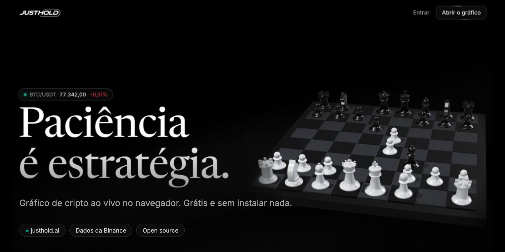
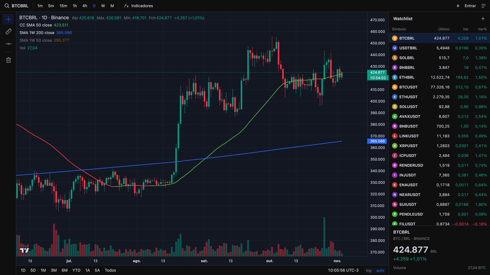

<p align="center">
  <a href="https://justhold.ai/?lang=en">
    
  </a>
</p>

<p align="center">
  <a href="https://justhold.ai/?lang=en"></a>
  <a href="LICENSE"></a>
  <a href="https://github.com/romuloalcanfor/justhold/stargazers"></a>
  
</p>

<p align="center">
  <a href="README.md">Português</a> · <b>English</b>
</p>

<p align="center">
  <b>A live crypto chart, right in your browser.</b><br>
  Free, open source, nothing to install. Built by someone tired of paying a subscription to look at candles.
</p>

<p align="center">
  <a href="https://justhold.ai/?lang=en"><b>Open the site</b></a> ·
  <a href="https://justhold.ai/grafico/?lang=en"><b>Open the chart</b></a> ·
  <a href="#run-locally"><b>Run locally</b></a>
</p>

---

## Why

I used TradingView every day to follow crypto, but I only needed a fraction of it: clean candles, a few moving averages and my list of pairs. So I built my own.

**JustHold** is exactly that: a fast, good-looking chart with the indicators that matter for long-term thinking. No ads, no mandatory sign-up, no paid plan.

<p align="center">
  
</p>

## Features

- 📈 **Live prices** for any Binance pair (BTC, ETH, SOL and many more, in USDT, BRL and other quotes)
- ⏱️ **Timeframes**: 1m, 5m, 15m, 1h, 4h, daily, weekly and monthly
- 📊 **Moving averages built in**: SMA 50 colored by direction, plus weekly SMA 200 and SMA 50 on any timeframe
- 📏 **Measuring ruler**, TradingView style: price change, %, bars and time
- ⭐ **Watchlist** with daily change and drag-to-reorder
- 👤 **Optional account** (e-mail and password) to keep your settings on any device
- 🌎 **English and Portuguese**, times in your own time zone, works worldwide (including the US)
- ⚡ **Lightweight**: plain HTML, CSS and JavaScript, no framework, no build step

## How it works

| Part | Technology |
| --- | --- |
| Chart | [Lightweight Charts](https://github.com/tradingview/lightweight-charts) (TradingView, Apache 2.0) |
| Data | Binance public [market data API](https://developers.binance.com/docs/binance-spot-api-docs/faqs/market_data_only) (`data-api.binance.vision`, REST + WebSocket) |
| Homepage | HTML/CSS + [three.js](https://threejs.org) |
| Hosting and accounts | [Cloudflare Workers](https://workers.cloudflare.com) + D1 |

```
public/          static site (homepage, /grafico and /entrar)
src/worker.js    accounts API (/api/*)
migrations/      D1 database
wrangler.jsonc   Cloudflare config
```

## Run locally

Just the site (no accounts):

```bash
python3 -m http.server 5173 --directory public
```

Open http://localhost:5173

With the accounts API, using Wrangler:

```bash
npx wrangler d1 migrations apply justhold --local
npx wrangler dev
```

## Deploy

```bash
npx wrangler d1 migrations apply justhold --remote
npx wrangler deploy
```

## Roadmap

- [ ] More assets beyond crypto
- [ ] Drawings saved to your account
- [ ] Price alerts
- [ ] AI-assisted chart analysis

Ideas and bug reports are welcome in [issues](https://github.com/romuloalcanfor/justhold/issues) and [discussions](https://github.com/romuloalcanfor/justhold/discussions).

## Support the project

If JustHold is useful to you, the easiest way to help is to **leave a ⭐ here on GitHub**. It helps the project reach more people.

## Disclaimer

JustHold shows public market data and is not investment advice. Do your own research.

## License

The chart and the rest of the code are [MIT](LICENSE) licensed © Romulo Alcanfor.

The 3D chess animation, the animated logo and the JustHold brand are **not** open source: all rights reserved. See [NOTICE](NOTICE.md).
