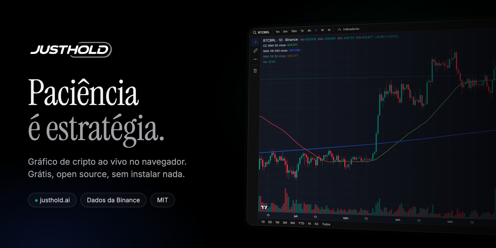
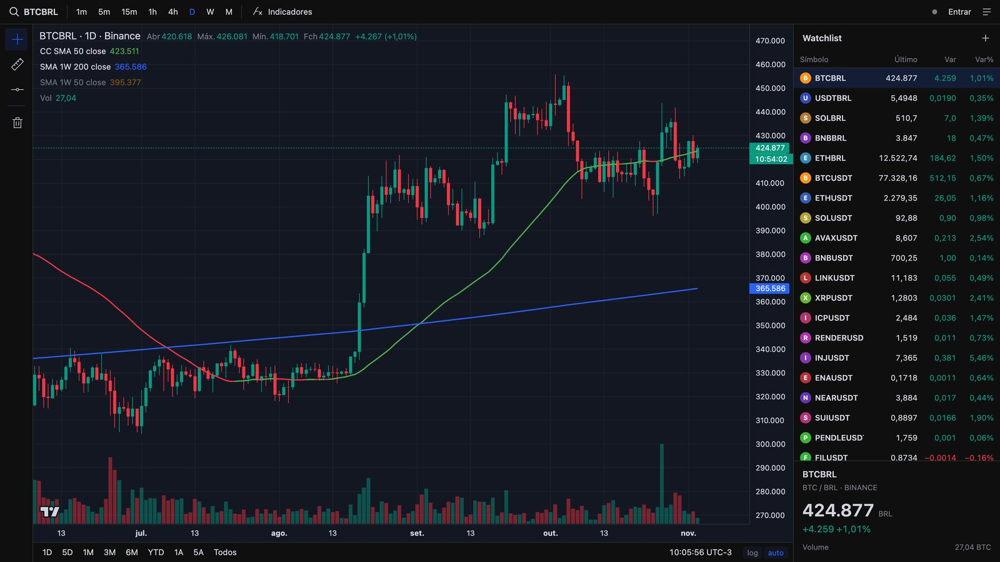

<p align="center">
  <a href="https://justhold.ai">
    
  </a>
</p>

<p align="center">
  <a href="https://justhold.ai"></a>
  <a href="LICENSE"></a>
  <a href="https://github.com/romuloalcanfor/justhold/stargazers"></a>
  
</p>

<p align="center">
  <b>Gráfico de cripto ao vivo, direto no navegador.</b><br>
  Grátis, open source e sem instalar nada. Feito por quem cansou de pagar assinatura para ver um candle.
</p>

<p align="center">
  <a href="https://justhold.ai"><b>Abrir o site</b></a> ·
  <a href="https://justhold.ai/grafico/"><b>Abrir o gráfico</b></a> ·
  <a href="#rodar-local"><b>Rodar local</b></a>
</p>

---

## Por que existe

Eu usava o TradingView todo dia para acompanhar cripto, mas só precisava de uma fração do que ele oferece: candles limpos, algumas médias móveis e minha lista de pares. Então fiz o meu.

O **JustHold** é isso: um gráfico rápido, bonito e com os indicadores que importam para quem pensa no longo prazo. Sem anúncio, sem cadastro obrigatório, sem plano pago.

<p align="center">
  
</p>

## O que tem

- 📈 **Preço ao vivo** de qualquer par da Binance (BTC, ETH, SOL e muitos outros, em BRL ou USDT)
- ⏱️ **Vários tempos gráficos**: 1m, 5m, 15m, 1h, 4h, diário, semanal e mensal
- 📊 **Médias móveis prontas**: SMA 50 com cor pela direção, SMA 200 e SMA 50 semanais em qualquer tempo gráfico
- 📏 **Régua de medição** no estilo TradingView: variação de preço, %, barras e tempo
- ⭐ **Watchlist** com seus pares, variação do dia e arrastar para reordenar
- 👤 **Conta opcional** (e-mail e senha) para guardar suas preferências em qualquer aparelho
- ⚡ **Leve**: HTML, CSS e JavaScript puros, sem framework e sem etapa de build

## Como funciona

| Parte | Tecnologia |
| --- | --- |
| Gráfico | [Lightweight Charts](https://github.com/tradingview/lightweight-charts) (TradingView, Apache 2.0) |
| Dados | API pública da [Binance](https://binance-docs.github.io/apidocs/spot/en/) (REST + WebSocket) |
| Homepage | HTML/CSS + [three.js](https://threejs.org) |
| Hospedagem e contas | [Cloudflare Workers](https://workers.cloudflare.com) + D1 |

```
public/          site estático (homepage, /grafico e /entrar)
src/worker.js    API de contas (/api/*)
migrations/      banco D1
wrangler.jsonc   configuração da Cloudflare
```

## Rodar local

Só o site (sem contas):

```bash
python3 -m http.server 5173 --directory public
```

Abra http://localhost:5173

Com a API de contas, usando o Wrangler:

```bash
npx wrangler d1 migrations apply justhold --local
npx wrangler dev
```

## Publicar

```bash
npx wrangler d1 migrations apply justhold --remote
npx wrangler deploy
```

## Próximos passos

- [ ] Mais ativos além de cripto
- [ ] Desenhos salvos na conta
- [ ] Alertas de preço
- [ ] Análise gráfica com IA

Ideias e bugs são bem-vindos nas [issues](https://github.com/romuloalcanfor/justhold/issues).

## Apoie o projeto

Se o JustHold te ajudou, a forma mais simples de apoiar é **deixar uma ⭐ aqui no GitHub**. Isso ajuda o projeto a chegar em mais gente.

Compartilhar o link com quem acompanha cripto também ajuda muito.

## Aviso

O JustHold mostra dados públicos de mercado e não é recomendação de investimento. Faça sua própria análise.

## Licença

[MIT](LICENSE) © Romulo Alcanfor
