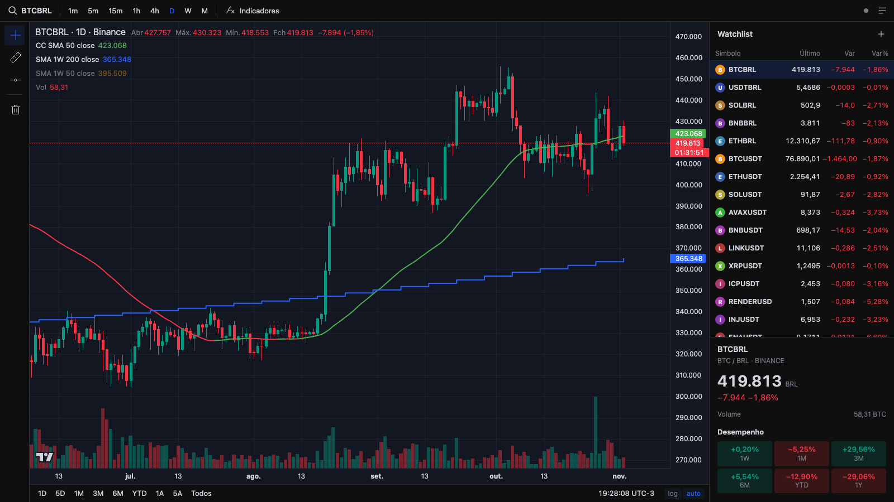

# JustHold

**Gráfico de cripto ao vivo, no estilo TradingView, grátis e sem login.**
*Live crypto charts, TradingView-style, free and open source.*

[](https://justhold.ai)
[](LICENSE)
[](grafico/)

**👉 [Abrir o gráfico: justhold.ai](https://justhold.ai)**



## Por que existe

Eu usava o TradingView todo dia, mas só alguns recursos dele. A assinatura venceu e eu montei
o meu próprio gráfico: os mesmos indicadores que eu uso, com dados públicos da Binance, sem
anúncio e sem pagar nada.

## O que tem

- **Candles ao vivo** pelo WebSocket da Binance, com contagem regressiva até o fechamento da vela
- **Tempos gráficos** de 1m, 5m, 15m, 1h, 4h, D, W e M, e atalhos de período (1D, 5D, 1M, 3M, 6M, YTD, 1A, 5A, Todos)
- **Médias móveis**: SMA 50 que muda de cor conforme a direção, e SMA 200 / SMA 50 do semanal sobrepostas em qualquer tempo gráfico
- **Watchlist** com pares em BRL e USDT, variação do dia e desempenho (1W, 1M, 3M, 6M, YTD, 1A). Dá para reordenar arrastando
- **Ferramentas**: régua (Shift + clique) com variação de preço e de tempo, e linhas horizontais (Alt + H)
- **Escala logarítmica**, autoescala e histórico infinito ao arrastar para a esquerda
- **Busca** de qualquer par listado na Binance
- Suas preferências ficam salvas no navegador

## Como funciona

HTML, CSS e JavaScript puro, **sem build e sem dependências de npm**. Os gráficos usam o
[Lightweight Charts](https://github.com/tradingview/lightweight-charts) (TradingView, Apache 2.0)
e os dados vêm direto da [API pública da Binance](https://developers.binance.com/docs/binance-spot-api-docs),
sem servidor no meio. O site é publicado na Cloudflare (Workers + assets).

```
grafico/
├── index.html
├── styles.css
├── js/
│   ├── app.js         # interface, watchlist e ferramentas
│   ├── api.js         # REST e WebSocket da Binance
│   ├── indicators.js  # médias móveis
│   └── ruler.js       # régua de medição
└── vendor/lightweight-charts.js
```

## Rodar local

```bash
git clone https://github.com/romuloalcanfor/justhold.git
cd justhold
python3 -m http.server 5173 --directory grafico
```

Abra http://localhost:5173

## Publicar

```bash
npx wrangler deploy
```

## Próximos passos

- [ ] Mais indicadores (EMA, RSI, Bollinger)
- [ ] Alertas de preço
- [ ] Outros ativos além de cripto
- [ ] Bot que executa regras objetivas de trade, com backtest antes de usar dinheiro real

Ideias e bugs são bem-vindos nas [issues](https://github.com/romuloalcanfor/justhold/issues).

## Apoie

Se o JustHold te ajuda, deixe uma ⭐ aqui no repositório. Isso ajuda outras pessoas a encontrarem o projeto.

## Aviso

O JustHold mostra dados públicos de mercado e **não é recomendação de investimento**.

## Licença

[MIT](LICENSE) © Rômulo Alcanfor
